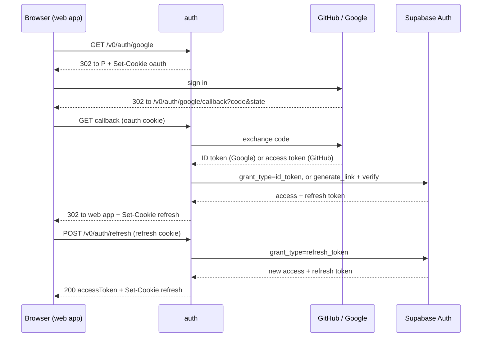

# Auth service design (draft)

Status: proposal for review. No code yet.

## Scope

- In scope: web sign-in with GitHub or Google, with Supabase Auth as the user store and token issuer, and token refresh.
- Out of scope: sign-out, JWT verification in other services, CLI and extension sign-in, sign-up, profile, and MFA.

## Constraints

- No client connects to Supabase, not even by browser redirect to `<project_ref>.supabase.co`.
  All client traffic goes to `auth` (for example `https://auth.keysy.net`).
- Each service has its own subdomain of `keysy.net`, so the web app and `auth` are same-site but cross-origin.
- Supabase refresh tokens never expire. Keysy adds no time-box or inactivity limit.

## Meeting the no-Supabase rule

Supabase's own OAuth flow (`/auth/v1/authorize`) sends the browser to Supabase twice:
to `/authorize`, and back from GitHub or Google to Supabase's `/auth/v1/callback`.
So the native flow breaks the rule for both providers.

| Option | Pros | Cons |
| --- | --- | --- |
| A. Supabase [custom domain](https://supabase.com/docs/guides/platform/custom-domains) (for example `sb.keysy.net`). | No new auth logic. The browser sees only `keysy.net` names. | The browser still connects to a Supabase-hosted server. The `supabase.co` URL keeps working. It costs [$10 per month](https://supabase.com/docs/guides/platform/manage-your-usage/custom-domains) on a paid plan (Pro is $25 per month). It does not meet the rule. |
| B. `auth` runs the provider OAuth flow. It then calls Supabase server to server. (**Recommended**) | Meets the rule for both providers. The browser sees only `auth`, GitHub, and Google. | The GitHub path adds auth logic (see below). `auth` holds the Supabase secret key. |
| C. `auth` reverse-proxies Supabase's `/authorize` and `/callback`. | Keeps Supabase's flow. | Supabase puts its own host in the provider `redirect_uri`. Rewriting it breaks the code exchange, because the exchange must send the same `redirect_uri` ([RFC 6749, section 4.1.3](https://www.rfc-editor.org/rfc/rfc6749#section-4.1.3)). This depends on Supabase internals. Rejected. |

How B works per provider:

- **Google:** `auth` exchanges the code with Google and gets an OIDC ID token.
  It sends the token to Supabase `POST /auth/v1/token?grant_type=id_token`. Supabase checks the signature and audience,
  and records a Google identity. Supabase does all identity checks.
- **GitHub:** GitHub OAuth apps issue no ID token. Supabase's `id_token` grant accepts only OIDC issuers
  (Google, Apple, Azure, Facebook, Keycloak, Kakao, Snapchat, Vercel Marketplace, and custom OIDC providers;
  see [`token_oidc.go`](https://github.com/supabase/auth/blob/master/internal/api/token_oidc.go)). So GitHub cannot use it.
  Fallback: `auth` reads the user's primary verified email from GitHub (`GET /user/emails`).
  It then calls Supabase `POST /auth/v1/admin/generate_link` (`type: magiclink`) with the secret key.
  This finds or creates the user and returns `hashed_token`. It sends no email
  ([`mail.go`](https://github.com/supabase/auth/blob/master/internal/api/mail.go)).
  Then `auth` calls `POST /auth/v1/verify` with `token_hash`, which returns a session
  ([`verify.go`](https://github.com/supabase/auth/blob/master/internal/api/verify.go)).
  Supabase stores this user as an email user, not as a GitHub identity.

Why B: it is the only option that meets the rule for both providers.
The cost is the GitHub path: `auth` decides that the GitHub email is verified, and it holds a key that can act as any user.
The simpler way to meet the rule is Google only. That needs no secret key and no custom logic (open question 1).

## Token placement

| Option | Pros | Cons |
| --- | --- | --- |
| B1. Refresh token in an `HttpOnly` cookie on `auth`. The access token goes to the web app in JSON. (**Recommended**) | XSS cannot steal the refresh token. The API keeps `bearerAuth` from `openapi/api.yaml`. The cookie stays host-only on `auth`. | XSS can still use or steal an access token. It lives at most one hour (Supabase default). |
| B2. Both tokens in `HttpOnly` cookies. The API reads the access token from a cookie. | JavaScript never sees a token. RFC 10017 prefers this (BFF, section 6.1). | The API is on another subdomain. To share the cookie, it needs `Domain=keysy.net`, which sends it to every subdomain. The API must also add CSRF checks to every write. |

Why B1: it is RFC 10017's token-mediating backend (section 6.2). It keeps the long-lived token off the browser
and off every other subdomain, and it does not change the API.

## Endpoints

### `GET /v0/auth/{provider}`

The web app links here. `provider` is `github` or `google`. Other values return `400`.

1. Create a random `state` and a PKCE `code_verifier`. Both providers support PKCE with `S256`
   ([Google](https://developers.google.com/identity/protocols/oauth2/web-server),
   [GitHub](https://github.blog/changelog/2025-07-14-pkce-support-for-oauth-and-github-app-authentication/)).
2. Set `__Host-keysy-oauth` to `state` and the verifier.
3. Redirect (`302`) to the provider's authorize URL with `client_id`, `redirect_uri={AUTH_URL}/v0/auth/{provider}/callback`,
   `state`, `code_challenge`, and `code_challenge_method=S256`.
   Scopes: `openid email` for Google, `user:email` for GitHub.

### `GET /v0/auth/{provider}/callback?code=...&state=...`

The provider redirects here.

1. Compare `state` with the cookie. If it differs or the cookie is missing, fail. This blocks login CSRF.
2. Exchange `code` and the verifier at the provider's token endpoint with the client secret.
3. Get a Supabase session:
   - Google: `POST {SUPABASE_URL}/auth/v1/token?grant_type=id_token` with `{"provider": "google", "id_token": ...}`.
     There is no nonce, because the ID token goes from Google to `auth` directly and never passes through the browser.
   - GitHub: read `/user/emails`. Take the email that is `primary` and `verified`; if there is none, fail.
     Then call `generate_link` and `verify` as above.
4. Set `__Host-keysy-refresh` to the refresh token. Clear `__Host-keysy-oauth`.
5. Redirect (`302`) to `WEB_APP_URL`.

On any failure, redirect to `{WEB_APP_URL}/?sign_in_error=1`. Provider error text is not copied into the URL.

### `POST /v0/auth/refresh`

The web app calls `fetch("{AUTH_URL}/v0/auth/refresh", { method: "POST", credentials: "include" })`
on page load, before the access token expires, and after a `401` from the API.

1. Return `403` if `Origin` is missing or is not exactly the origin of `WEB_APP_URL`.
2. Read `__Host-keysy-refresh`. If it is missing, return `401`.
3. `POST {SUPABASE_URL}/auth/v1/token?grant_type=refresh_token` with header `apikey` and body `{"refresh_token": ...}`.
4. Set `__Host-keysy-refresh` to the rotated token.
5. Return `200`:

```json
{ "accessToken": "<Supabase JWT>", "tokenType": "bearer", "expiresIn": 3600 }
```

If Supabase rejects the token, clear the cookie and return `401`. The web app then shows sign-in.

Every response from this endpoint, including errors, has these headers:
`Access-Control-Allow-Origin: {WEB_APP_URL origin}`, `Access-Control-Allow-Credentials: true`, `Vary: Origin`,
and `Cache-Control: no-store`.
The request is a CORS simple request (POST, no body, no custom headers), so there is no preflight.

## Sequence



## Cookies and CSRF

| Cookie | Value | Attributes |
| --- | --- | --- |
| `__Host-keysy-oauth` | `state` and PKCE verifier | `HttpOnly; Secure; SameSite=Lax; Path=/; Max-Age=600` |
| `__Host-keysy-refresh` | Refresh token | `HttpOnly; Secure; SameSite=Strict; Path=/; Max-Age=34560000` |

- No cookie sets `Domain`. Each cookie stays on `auth.keysy.net`. The API, the wiki, and other subdomains never receive it.
- The `__Host-` prefix needs `Secure`, `Path=/`, and no `Domain`. It also stops a sibling subdomain from setting a cookie
  with the same name (cookie tossing). RFC 10017 recommends it for this reason.
- `SameSite=Strict` works for refresh. The web app's subdomain and `auth` are the same site, so a credentialed `fetch` sends the cookie.
- The OAuth cookie uses `Lax`, because the provider's redirect to the callback is a cross-site navigation. `Strict` would drop it.
- `Max-Age=34560000` is 400 days, the longest lifetime that browsers keep
  ([RFC 6265bis](https://datatracker.ietf.org/doc/draft-ietf-httpbis-rfc6265bis/)). Each refresh sets it again,
  so an active user stays signed in. A browser that is idle for 400 days signs in again.
- `SameSite` does not block requests from sibling subdomains, because they are the same site. The exact `Origin` check is the
  CSRF defense for refresh ([OWASP](https://cheatsheetseries.owasp.org/cheatsheets/Cross-Site_Request_Forgery_Prevention_Cheat_Sheet.html)).
- The web app keeps the access token in memory only.
- Supabase refresh tokens are single-use, with a 10-second reuse window, so two tabs can refresh at once.
  Other reuse revokes the whole session ([Sessions](https://supabase.com/docs/guides/auth/sessions)).

## Pitfalls from an earlier project

### Open redirect through `next`

A `next` check that blocks only `/` and `\` at index 1 fails. Browsers strip tabs and newlines from URLs,
so `/\t//evil.com` becomes `///evil.com`, which browsers read as the host `evil.com`.

How this design avoids it: no endpoint takes a `next` or return URL. The provider `redirect_uri` and the final redirect
come from configuration only. If a return-to-page feature is needed later, accept only exact paths from a fixed allow-list.

### Re-sign-in after account deletion

After account deletion, a new sign-in with the same email creates a new Supabase user ID.
Code that does "select by ID, else insert" without `ON CONFLICT` hits the unique email constraint and returns `500`.

How this design avoids it: `auth` writes no Keysy rows, so its callback cannot fail this way.
The component that links `members.user_id` (open question 4) must match by verified email in one statement that is safe to repeat,
for example `UPDATE members SET user_id = :id WHERE email = :email`. Any insert uses `ON CONFLICT` on the unique key.
It never selects, then inserts.

## Configuration

| Variable | Purpose |
| --- | --- |
| `PORT` | HTTP listen port. |
| `AUTH_URL` | Public base URL of `auth`, for example `https://auth.keysy.net`. Builds the provider callback URLs. |
| `WEB_APP_URL` | Redirect target after sign-in, and the only allowed `Origin` for refresh. |
| `SUPABASE_URL` | Supabase project URL. |
| `SUPABASE_PUBLISHABLE_KEY` | `apikey` header for `token` and `verify`. |
| `SUPABASE_SECRET_KEY` | Only for `admin/generate_link` (GitHub). A secret. |
| `GOOGLE_CLIENT_ID`, `GOOGLE_CLIENT_SECRET` | Google OAuth web client. |
| `GITHUB_CLIENT_ID`, `GITHUB_CLIENT_SECRET` | GitHub OAuth app. |

- Register `{AUTH_URL}/v0/auth/google/callback` with Google, and `{AUTH_URL}/v0/auth/github/callback` with GitHub.
- In Supabase, enable the Google provider with `GOOGLE_CLIENT_ID`, so that Supabase accepts the ID token's audience.
  Supabase's Redirect URLs allowlist and its GitHub provider are not used.

`auth` has no database and does not use GORM. It uses `net/http` for all outbound calls.

## Simpler alternatives

- Google only. This meets the no-Supabase rule with no secret key and no custom identity logic.
- Put the three routes in the `api` service. This saves one deployable, but it mixes auth with app logic.

## Open questions

1. GitHub and the no-Supabase rule: no native Supabase flow meets the rule. Option B meets it, but for GitHub, `auth` must hold
   the Supabase secret key and trust GitHub's verified email itself. Accept this, drop GitHub (Google only),
   or relax the rule for GitHub (custom domain)?
2. Token placement: B1 or B2?
3. Return to page: is a "return to the page I opened" feature needed in v0? This design has none.
4. Member linking: which component sets `members.user_id` at first sign-in: a database trigger or `api`?
5. Account linking: Google and GitHub sign-ins with the same verified email become one Supabase user. Is this acceptable?
6. Doc location: keep this file in `auth/`, or move it to a wiki page after approval?

## References

- [RFC 10017: OAuth 2.0 for Browser-Based Applications](https://datatracker.ietf.org/doc/rfc10017/) (sections 6.1 and 6.2, cookie rules)
- [Supabase: Custom domains](https://supabase.com/docs/guides/platform/custom-domains) and [pricing](https://supabase.com/docs/guides/platform/manage-your-usage/custom-domains)
- [Supabase: Google sign-in](https://supabase.com/docs/guides/auth/social-login/auth-google) (ID token, client IDs)
- [Supabase: Sessions](https://supabase.com/docs/guides/auth/sessions) (rotation, reuse window, reuse detection)
- [Supabase: Identity linking](https://supabase.com/docs/guides/auth/auth-identity-linking)
- Supabase Auth source: [`token_oidc.go`](https://github.com/supabase/auth/blob/master/internal/api/token_oidc.go),
  [`mail.go`](https://github.com/supabase/auth/blob/master/internal/api/mail.go),
  [`verify.go`](https://github.com/supabase/auth/blob/master/internal/api/verify.go),
  [`token.go`](https://github.com/supabase/auth/blob/master/internal/api/token.go)
- [GitHub: Authorizing OAuth apps](https://docs.github.com/en/apps/oauth-apps/building-oauth-apps/authorizing-oauth-apps)
  and [PKCE support](https://github.blog/changelog/2025-07-14-pkce-support-for-oauth-and-github-app-authentication/)
- [Google: OAuth 2.0 for web server apps](https://developers.google.com/identity/protocols/oauth2/web-server)
- [RFC 6749, section 4.1.3](https://www.rfc-editor.org/rfc/rfc6749#section-4.1.3) (`redirect_uri` must match)
- [OWASP: CSRF prevention](https://cheatsheetseries.owasp.org/cheatsheets/Cross-Site_Request_Forgery_Prevention_Cheat_Sheet.html)
