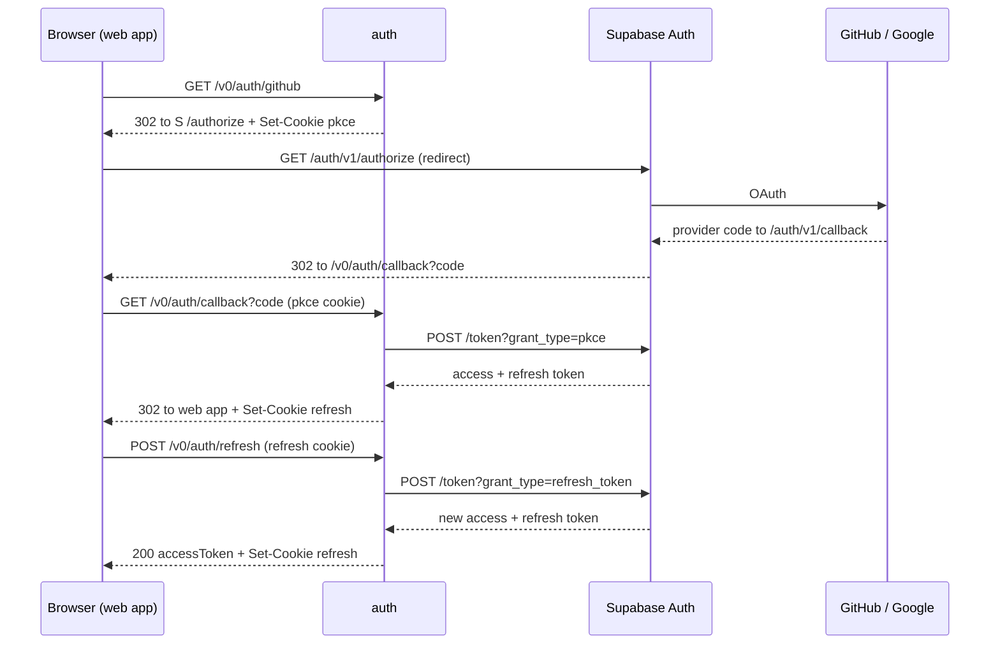

# Auth service design (draft)

Status: proposal for review. No code yet.

## Scope

- In scope: web sign-in with GitHub or Google through Supabase Auth, and token refresh.
- Out of scope: sign-out, JWT verification in other services, CLI and extension sign-in, sign-up, profile, and MFA.

## Constraints

- The web app never calls Supabase. All sign-in and refresh calls go through `auth`.
- The browser still passes through Supabase by redirect. It opens `/auth/v1/authorize`, and GitHub or Google
  return to `/auth/v1/callback` on the Supabase host. Web app code never calls these URLs.
- `auth` does not copy Supabase Auth logic. Supabase runs OAuth, PKCE checks, identity linking, and token rotation.

## What the service adds

`auth` keeps the refresh token and the PKCE verifier in `HttpOnly` cookies.
Browser JavaScript cannot read them, so an XSS bug cannot steal a long-lived session.

`@supabase/ssr` does not do this. Its default cookie is `httpOnly: false`, `sameSite: lax`, `path: /`,
and `maxAge` 400 days, because its browser client must read the session.
`auth` does not use the `sb-<project_ref>-auth-token` cookie format.

`auth` has no database and does not use GORM. It calls two Supabase Auth endpoints with `net/http`:
`GET /authorize` (by browser redirect) and `POST /token`.
It does not use a Go SDK. [`auth-go`](https://github.com/supabase-community/auth-go) is not maintained,
and the community [`supabase-go`](https://pkg.go.dev/github.com/antoineross/supabase-go) adds a dependency for two HTTP calls.
We found no public Go example of this pattern. The design follows RFC 10017 and the Supabase Auth source.

## Token placement

| Option | Pros | Cons |
| --- | --- | --- |
| B. Refresh token in an `HttpOnly` cookie. The access token goes to the web app in JSON. (**Recommended**) | XSS cannot steal the refresh token. The API keeps its `bearerAuth` contract from `openapi/api.yaml`. CSRF checks apply only to `/v0/auth/refresh`. | XSS can still use or steal an access token. It lives at most one hour (Supabase default). |
| C. Both tokens in `HttpOnly` cookies. The API reads the access token from a cookie. | JavaScript never sees a token. RFC 10017 prefers this (BFF, section 6.1). | The API must accept cookies and add CSRF checks to every write. That work is outside this scope. |

Rejected: the web app calls Supabase directly with `supabase-js`. This breaks the constraint above.

Why B: it is RFC 10017's token-mediating backend (section 6.2). It removes the largest risk, a stolen refresh token,
and it does not change the API. Move to C if a stolen one-hour access token is not acceptable.

One gap applies to both options. RFC 10017 asks the backend to be a confidential client.
Supabase's PKCE grant has no client secret, so `auth` is a public client to Supabase.
The refresh token still never reaches the browser.

## Endpoints

### `GET /v0/auth/{provider}`

Starts sign-in. `provider` is `github` or `google`. Other values return `400`.

1. Create a random 32-byte `code_verifier`. Compute `code_challenge = BASE64URL(SHA256(code_verifier))`.
2. Set the `__Secure-keysy-pkce` cookie to the verifier.
3. Redirect (`302`) to
   `{SUPABASE_URL}/auth/v1/authorize?provider={provider}&redirect_to={AUTH_CALLBACK_URL}&code_challenge={challenge}&code_challenge_method=s256`.

`redirect_to` always comes from configuration, never from the request.

### `GET /v0/auth/callback?code=...`

Supabase redirects here after sign-in.

1. Read the verifier from `__Secure-keysy-pkce`. If it is missing, fail.
2. `POST {SUPABASE_URL}/auth/v1/token?grant_type=pkce` with header `apikey: {SUPABASE_PUBLISHABLE_KEY}`
   and body `{"auth_code": code, "code_verifier": verifier}`.
3. Set `__Secure-keysy-refresh` to the new refresh token. Clear `__Secure-keysy-pkce`.
4. Redirect (`302`) to `WEB_APP_URL`.

On failure, or when Supabase sends `error`, redirect to `{WEB_APP_URL}/?sign_in_error=1`.
`auth` does not copy Supabase's `error_description` into the URL.

The verifier cookie also blocks login CSRF. An attacker's `code` fails without the victim's verifier.

### `POST /v0/auth/refresh`

The web app calls this on page load, before the access token expires, and after a `401` from the API.

1. Return `403` if `Origin` is not exactly the origin of `WEB_APP_URL`.
2. Read `__Secure-keysy-refresh`. If it is missing, return `401`.
3. `POST {SUPABASE_URL}/auth/v1/token?grant_type=refresh_token` with header `apikey` and body `{"refresh_token": token}`.
4. Set `__Secure-keysy-refresh` to the rotated token.
5. Return `200` with `Cache-Control: no-store`:

```json
{ "accessToken": "<Supabase JWT>", "tokenType": "bearer", "expiresIn": 3600 }
```

If Supabase rejects the token, clear the cookie and return `401`. The web app then shows sign-in.

## Sequence



## Token handling

| Cookie | Value | Attributes |
| --- | --- | --- |
| `__Secure-keysy-pkce` | PKCE verifier | `HttpOnly; Secure; SameSite=Lax; Path=/v0/auth/callback; Max-Age=300` |
| `__Secure-keysy-refresh` | Refresh token | `HttpOnly; Secure; SameSite=Strict; Path=/v0/auth/refresh; Max-Age=<open question>` |

- The PKCE cookie uses `Lax`, because the callback is a cross-site redirect from Supabase. `Strict` would drop it.
  Supabase codes live 5 minutes and work once, so `Max-Age=300` matches.
- The refresh cookie uses `Strict` and a narrow `Path`. The browser sends it only to `/v0/auth/refresh`.
  A narrow path rules out the `__Host-` prefix, which needs `Path=/`. Neither cookie sets `Domain`.
- The refresh cookie holds only the refresh token, not the full session. It stays far below the 4 KB limit,
  so it needs no chunking (`@supabase/ssr` chunks at 3180 bytes because it stores the full session).
- The web app keeps the access token in memory only. It never writes it to storage.
- Supabase refresh tokens are single-use. Supabase allows reuse for 10 seconds, so two tabs can refresh at once.
  Tabs share the cookie, so a later refresh reads the latest token.
  If a response is lost, the parent token returns the active token.
  Other reuse counts as a leak: Supabase revokes the whole session, and the user signs in again.

## Pitfalls from an earlier project

### Open redirect through `next`

A `next` check that blocks only `/` and `\` at index 1 fails. Browsers strip tabs and newlines from URLs,
so `/\t//evil.com` becomes `///evil.com`, which browsers read as the host `evil.com`.

How this design avoids it: no endpoint takes a `next` or return URL.
After sign-in, `auth` always redirects to `WEB_APP_URL`. `redirect_to` also comes from configuration only.
If a return-to-page feature is needed later, accept only exact paths from a fixed allow-list.
Do not use prefix or character checks.

### Re-sign-in after account deletion

After account deletion, a new sign-in with the same email creates a new Supabase user ID.
Code that does "select by ID, else insert" without `ON CONFLICT` hits the unique email constraint and returns `500`.

How this design avoids it: `auth` writes no rows, so the callback cannot fail this way.
The component that links `members.user_id` at first sign-in (open question 7) must follow two rules:

- Match by verified email, not by user ID. Use one statement that is safe to repeat, for example
  `UPDATE members SET user_id = :id WHERE email = :email`. Any insert uses `ON CONFLICT` on the unique key.
- Never do a separate select, then insert.

## Configuration

| Variable | Purpose |
| --- | --- |
| `PORT` | HTTP listen port. |
| `SUPABASE_URL` | Supabase project URL. |
| `SUPABASE_PUBLISHABLE_KEY` | Sent as the `apikey` header. Public, not a secret. |
| `AUTH_CALLBACK_URL` | Full URL of `/v0/auth/callback`. |
| `WEB_APP_URL` | Redirect target after sign-in, and the allowed `Origin` for refresh. |

Supabase project settings:

- Enable the GitHub and Google providers. Their client IDs and secrets live in Supabase, not in `auth`.
- Add `AUTH_CALLBACK_URL` to Redirect URLs as an exact URL, without wildcards.
  If `redirect_to` does not match, Supabase does not return an error. It redirects to the Site URL instead.
  Supabase also accepts any `redirect_to` on the Site URL's host.

## Simpler alternative

Put the three routes in the `api` service. This saves one deployable.
It mixes auth with app logic and differs from the architecture diagram, which shows a separate `auth` service.

## Open questions

1. Token placement: approve B, or choose C?
2. Hosting: does `auth` share the web app's origin (path routing through `deploy/nginx.conf`), or use its own host?
   A separate host needs CORS with credentials on `/v0/auth/refresh`.
3. Session length: what `Max-Age` should the refresh cookie have? Supabase refresh tokens never expire.
   Time-box and inactivity limits need a Pro plan. Should we use them?
4. Supabase host: the browser visits `<project_ref>.supabase.co` during sign-in. Is this acceptable,
   or should we buy Supabase's custom domain add-on (paid plan) so that the URL is on a Keysy domain?
5. Existing docs: `openapi/auth.yaml`, the tech stack page, and the architecture diagram say Google only, and they include CLI,
   extension, and sign-out. Should the implementation PR update them?
6. Return to page: is a "return to the page I opened" feature needed in v0? This design has none.
7. Member linking: which component sets `members.user_id` at first sign-in: a database trigger or `api`?
8. Account linking: Supabase links GitHub and Google identities that share a verified email into one user.
   It does not link unverified emails. Is one Keysy user per verified email acceptable?
9. Doc location: keep this file in `auth/`, or move it to a wiki page after approval?

## References

- [RFC 10017: OAuth 2.0 for Browser-Based Applications](https://datatracker.ietf.org/doc/rfc10017/) (sections 6.1 BFF, 6.2 token-mediating backend, cookie rules)
- [Supabase: PKCE flow](https://supabase.com/docs/guides/auth/sessions/pkce-flow)
- [Supabase: Server-side auth, advanced guide](https://supabase.com/docs/guides/auth/server-side/advanced-guide)
- [Supabase: Sessions](https://supabase.com/docs/guides/auth/sessions) (refresh rotation, reuse interval, reuse detection)
- [Supabase: Redirect URLs](https://supabase.com/docs/guides/auth/redirect-urls)
- [Supabase: Identity linking](https://supabase.com/docs/guides/auth/auth-identity-linking)
- [Supabase: Custom domains](https://supabase.com/docs/guides/platform/custom-domains)
- [Supabase Auth OpenAPI](https://github.com/supabase/auth/blob/master/openapi.yaml)
- Supabase Auth source: [`external.go`](https://github.com/supabase/auth/blob/master/internal/api/external.go) (`code_challenge`),
  [`token.go`](https://github.com/supabase/auth/blob/master/internal/api/token.go) (`auth_code`, `code_verifier`),
  [`request.go`](https://github.com/supabase/auth/blob/master/internal/utilities/request.go) (`redirect_to` fallback)
- `@supabase/ssr` source: [`constants.ts`](https://github.com/supabase/ssr/blob/main/src/utils/constants.ts) (cookie defaults),
  [`chunker.ts`](https://github.com/supabase/ssr/blob/main/src/utils/chunker.ts) (chunk size)
- [OWASP: CSRF prevention](https://cheatsheetseries.owasp.org/cheatsheets/Cross-Site_Request_Forgery_Prevention_Cheat_Sheet.html) (Origin check)
