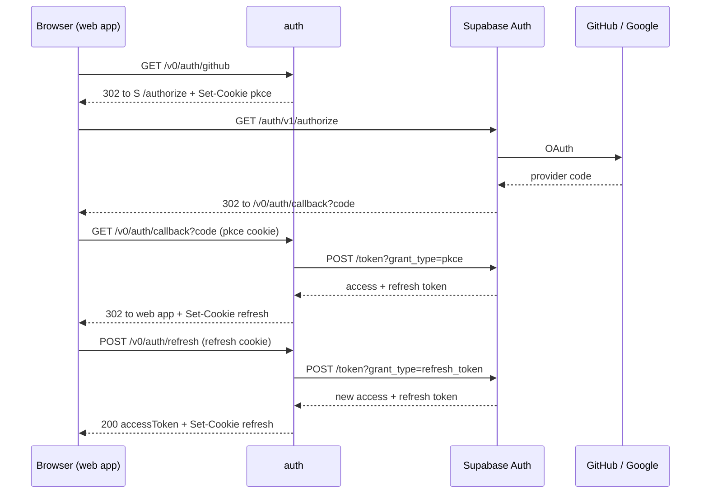

# Auth service design (draft)

Status: proposal for review. No code yet.

## Scope

- In scope: web sign-in with GitHub or Google through Supabase Auth, and token refresh.
- Out of scope: sign-out, JWT verification in other services, CLI and extension sign-in, sign-up, profile, and MFA.

## What the service adds

Supabase Auth already runs the OAuth flow, PKCE, the provider exchange, and token rotation.
The service adds one thing: it keeps the refresh token and the PKCE verifier in `HttpOnly` cookies.
Browser JavaScript cannot read these cookies, so an XSS bug cannot steal a long-lived session.

The service has no database. It does not use GORM.
It calls three Supabase Auth HTTP endpoints with `net/http`. It does not use a Supabase Go SDK,
because [`auth-go`](https://github.com/supabase-community/auth-go) is not maintained.

## Token placement

| Option | Pros | Cons |
| --- | --- | --- |
| A. No proxy. The web app uses `supabase-js` directly. | No backend code. Supabase's default for SPAs. | The refresh token is in `localStorage` or a script-readable cookie. XSS can steal it and keep access. [RFC 10017](https://datatracker.ietf.org/doc/rfc10017/) ranks this pattern lowest. |
| B. Refresh token in an `HttpOnly` cookie. The access token goes to the SPA in JSON. (**Recommended**) | XSS cannot steal the refresh token. The API keeps its `bearerAuth` contract from `openapi/api.yaml`. No CSRF risk on the API. | XSS can still steal an access token. The token lives at most one hour. |
| C. Both tokens in `HttpOnly` cookies. The API reads the cookie. | No token is visible to JavaScript. RFC 10017's preferred option. | The API must accept cookies and add CSRF checks. That is outside this scope. |

Why B: it is RFC 10017's "token-mediating backend". It removes the largest risk (a stolen refresh token)
and does not change the API.
Choose A if the team accepts the XSS risk for v0. A is simpler.
Choose C later if a stolen one-hour access token is not acceptable.

## Endpoints

### `GET /v0/auth/{provider}`

Starts sign-in. `provider` is `github` or `google`. Other values return `400`.

1. Create a random 32-byte `code_verifier`. Compute `code_challenge = BASE64URL(SHA256(code_verifier))`.
2. Set the `__Secure-keysy-pkce` cookie to the verifier.
3. Redirect (`302`) to
   `{SUPABASE_URL}/auth/v1/authorize?provider={provider}&redirect_to={AUTH_CALLBACK_URL}&code_challenge={challenge}&code_challenge_method=s256`.

### `GET /v0/auth/callback?code=...`

Supabase redirects here after sign-in.

1. Read the verifier from `__Secure-keysy-pkce`. If it is missing, fail.
2. `POST {SUPABASE_URL}/auth/v1/token?grant_type=pkce` with header `apikey: {SUPABASE_PUBLISHABLE_KEY}`
   and body `{"auth_code": code, "code_verifier": verifier}`.
3. Set `__Secure-keysy-refresh` to the new refresh token. Clear `__Secure-keysy-pkce`.
4. Redirect (`302`) to `WEB_APP_URL`.

On failure, or when Supabase sends an `error` parameter, redirect to `{WEB_APP_URL}/?sign_in_error=1`.
The service does not copy provider error text into the URL.

The verifier cookie also blocks login CSRF: an attacker's `code` fails without the victim's verifier.

### `POST /v0/auth/refresh`

The web app calls this on page load and before the access token expires.

1. Reject the request with `403` if `Origin` is not `WEB_APP_URL`'s origin.
2. Read `__Secure-keysy-refresh`. If it is missing, return `401`.
3. `POST {SUPABASE_URL}/auth/v1/token?grant_type=refresh_token` with header `apikey` and body `{"refresh_token": token}`.
4. Set `__Secure-keysy-refresh` to the rotated token.
5. Return `200` with `Cache-Control: no-store`:

```json
{ "accessToken": "<Supabase JWT>", "tokenType": "bearer", "expiresIn": 3600 }
```

If Supabase rejects the token, clear the cookie and return `401`. The web app then shows sign-in.

## Sequence



## Token handling

| Cookie | Value | Attributes |
| --- | --- | --- |
| `__Secure-keysy-pkce` | PKCE verifier | `HttpOnly; Secure; SameSite=Lax; Path=/v0/auth/callback; Max-Age=300` |
| `__Secure-keysy-refresh` | Refresh token | `HttpOnly; Secure; SameSite=Strict; Path=/v0/auth/refresh; Max-Age=<open question>` |

- The PKCE cookie uses `Lax`, because the callback is a cross-site redirect from Supabase. `Strict` would drop it.
  Supabase codes live 5 minutes, so `Max-Age=300` matches.
- The refresh cookie uses `Strict` and a narrow `Path`. The browser sends it only to `/v0/auth/refresh`.
  A narrow path rules out the `__Host-` prefix, which needs `Path=/`. Neither cookie sets `Domain`.
- The web app keeps the access token in memory only. It never writes it to storage.
- Supabase refresh tokens are single-use. A 10-second reuse window covers two tabs that refresh at once.
  Tabs share the cookie, so a later refresh reads the latest token.

## Configuration

| Variable | Purpose |
| --- | --- |
| `PORT` | HTTP listen port. |
| `SUPABASE_URL` | Supabase project URL. |
| `SUPABASE_PUBLISHABLE_KEY` | Sent as the `apikey` header. Public, not a secret. |
| `AUTH_CALLBACK_URL` | Full URL of `/v0/auth/callback`. Must be in Supabase's Redirect URLs allowlist as an exact match. |
| `WEB_APP_URL` | Redirect target after sign-in, and the allowed `Origin` for refresh. |

GitHub and Google client IDs and secrets live in the Supabase provider settings, not in this service.

## Simpler alternatives

- Option A above: skip the service. This is better if v0 accepts the XSS risk, or if the team wants zero backend auth code.
- Put the three routes in the `api` service. This saves one deployable. It mixes auth with app logic and differs from the
  current architecture diagram, which shows a separate `auth` service.

## Open questions

1. Token placement: approve option B, or choose A or C?
2. Hosting: does `auth` share the web app's origin (path routing through `deploy/nginx.conf`), or use its own host?
   A separate host needs CORS with credentials on `/v0/auth/refresh`.
3. Session length: what `Max-Age` should the refresh cookie have? Should Supabase time-box or inactivity limits apply?
4. Existing docs: `openapi/auth.yaml`, the tech stack page, and the architecture diagram say Google only and include CLI,
   extension, and sign-out. Update them in the implementation PR?
5. Landing page: always land on `WEB_APP_URL` after sign-in, or return to the page the user first opened?
6. Account linking: Supabase links GitHub and Google identities that share a verified email. Is this acceptable?
7. Member linking: `members.user_id` is set at first sign-in. Which component owns this (database trigger or `api`)?
8. Doc location: keep this file in `auth/`, or move it to a wiki page after approval?

## References

- [RFC 10017: OAuth 2.0 for Browser-Based Applications](https://datatracker.ietf.org/doc/rfc10017/) (BFF, token-mediating backend, cookie rules)
- [Supabase: PKCE flow](https://supabase.com/docs/guides/auth/sessions/pkce-flow)
- [Supabase: Sessions](https://supabase.com/docs/guides/auth/sessions) (refresh rotation, reuse interval)
- [Supabase: Redirect URLs](https://supabase.com/docs/guides/auth/redirect-urls)
- [Supabase Auth OpenAPI](https://github.com/supabase/auth/blob/master/openapi.yaml) (`/authorize`, `/token`)
- [OWASP: CSRF prevention](https://cheatsheetseries.owasp.org/cheatsheets/Cross-Site_Request_Forgery_Prevention_Cheat_Sheet.html) (Origin check)
