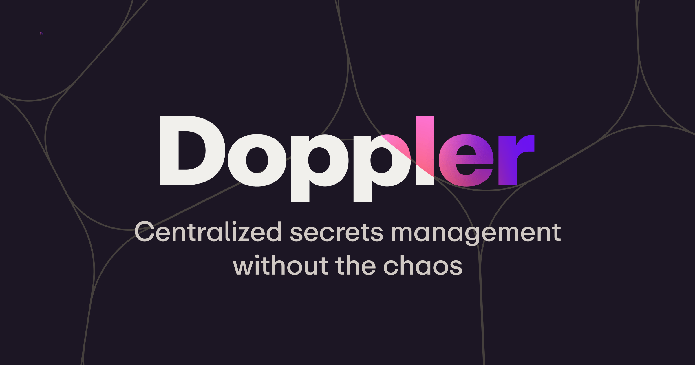
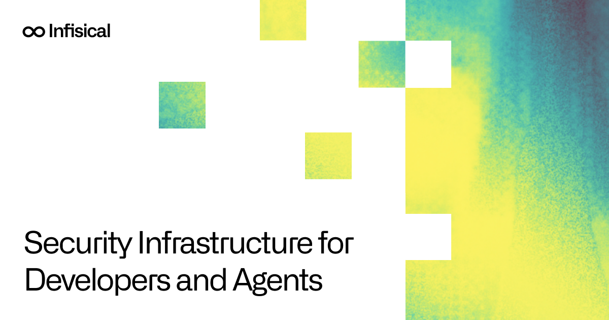
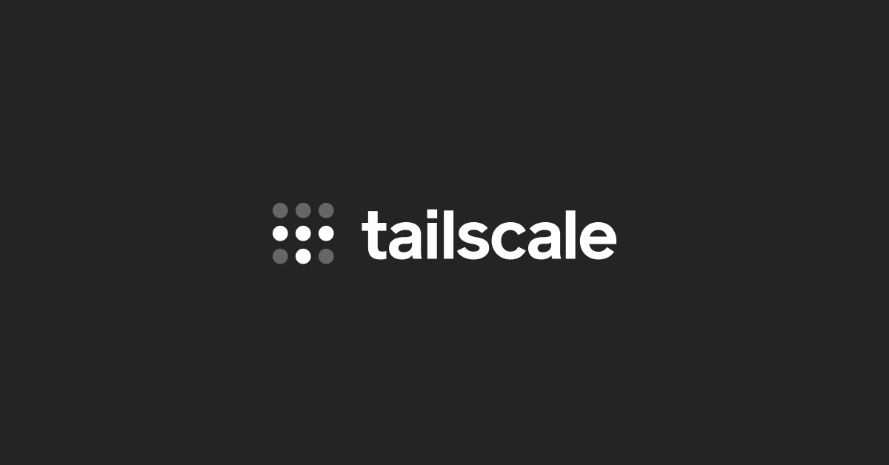
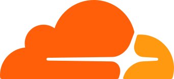
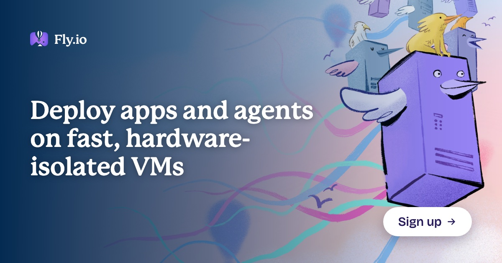

# Infrastructure brand references

Captured on October 19, 2026. Nine references spanning secrets management, backend platforms, deployment, and networking.

This archive contains official logos, selected official social preview artwork, design observations, and source links. Social previews are not browser screenshots. Motion has not been inspected in a browser. These are research references, not approved Keysy designs.

Assets retain their original geometry and colors. Three logos needed standalone viewport or page-CSS adjustments; their original SVGs are preserved beside the exports as `logo-source.svg`. Extraction and export details are recorded in [SOURCES.json](SOURCES.json), together with source URLs and SHA-256 checksums. Third-party marks remain subject to their owners' brand and trademark policies; this archive does not grant reuse rights.

## Index

| Company or project | Category | Local logo | Elements to study |
| --- | --- | --- | --- |
| [Doppler](#doppler) | Secrets management | [SVG](doppler/logo.svg) | Asterisk, Voronoi boundaries, terminal-inspired color |
| [Infisical](#infisical) | Security infrastructure | [SVG](infisical/logo.svg) | Infinity-like mark, grain, square cutouts, dense product UI |
| [Tailscale](#tailscale) | Secure networking | [SVG](tailscale/logo.svg) | Dot matrix, contrast, repeated geometric units |
| [Supabase](#supabase) | Backend platform | [SVG](supabase/logo.svg) | Lightning bolt, green identity, neutral interface surfaces |
| [Neon](#neon) | Postgres platform | [SVG](neon/logo.svg) | Angular N, green, black and off-white |
| [Vercel](#vercel) | Deployment platform | [SVG](vercel/logo.svg) | Triangle, monochrome, grid guides, typography |
| [Cloudflare](#cloudflare) | Network, security, and compute | [SVG](cloudflare/logo.svg) | Orange cloud, neutral typography, network concepts |
| [Fly.io](#flyio) | Application and VM hosting | [SVG](fly/logo.svg) | Hand-drawn characters, purple and blue, serif headlines |
| [OpenBao](#openbao) | Open-source secrets management | [SVG](openbao/logo.svg) | Three bao, greens and warm neutrals, mono wordmark |

## Doppler

- **Product:** Secrets management for development teams and automated workloads.
- **Logo:** The official rebrand describes an asterisk derived from secret masking. The saved logo is the homepage wordmark with pale lettering and colored detail; view it on a dark background.
- **Color and motifs:** The rebrand draws on terminal green and syntax highlighting. The archived social preview uses a dark purple field, pink-purple detail, and curved Voronoi boundaries. This preview is one application, not the complete palette.
- **Design lesson:** Start with a recognizable product interaction, then extend it into a symbol and a repeatable background language.
- **Trade-off:** A product-derived symbol communicates relevance, but common secret and security symbols require distinctive execution.
- **Sources:** [Homepage](https://www.doppler.com/), [official rebrand explanation, January 9, 2024](https://www.doppler.com/blog/rebrand-of-doppler).

## Infisical

- **Product:** Secrets, certificates, and privileged access infrastructure.
- **Brand observations:** Infinity-like black mark, large sans-serif text, white space, yellow-green grain, and square cutouts in the saved preview. The mark's meaning is not established by the sources below.
- **Local export:** Explicit dimensions preserve the logo's aspect ratio outside its original responsive page. The [original SVG](infisical/logo-source.svg) is retained.
- **Product UI:** The public v3 design document emphasizes calm, legible, information-dense screens, with restrained decoration. Borders and surface tones establish depth; scope and status colors convey meaning.
- **Typography:** The product document specifies IBM Plex Sans for UI, Alliance No. 2 for headings, and JetBrains Mono for secrets, code, identifiers, and logs. These are product specifications, not a verified font inventory for the marketing site.
- **Design lesson:** Give marketing surfaces a recognizable visual language while keeping operational screens focused on reading and actions.
- **Trade-off:** This supports both identity and usability, but requires clear rules for where decorative treatments belong.
- **Sources:** [Homepage](https://infisical.com/), [public v3 product design document](https://github.com/Infisical/infisical/blob/main/DESIGN.md).

## Tailscale

- **Product:** Secure connectivity between devices and services.
- **Logo observations:** A three-by-three arrangement of circles, differentiated by opacity, alongside a lowercase wordmark. The saved standalone SVG comes from the homepage.
- **Color and composition:** The saved social preview uses a charcoal background, white wordmark, and gray-to-white dots with generous empty space.
- **Design lesson:** A small family of repeated shapes can create recognition and suggest connections or nodes. This association is a design interpretation, not a verified official explanation of the mark.
- **Trade-off:** A compact abstract mark scales well, but the wordmark helps establish identity before the symbol becomes familiar.
- **Source:** [Official homepage](https://tailscale.com/).

## Supabase

- **Product:** A Postgres-based backend platform with database, authentication, storage, and related services.
- **Logo observations:** A green lightning bolt with two tonal portions and a neutral wordmark. The archived homepage SVG uses green `#3ECF8E` in its artwork; this is an asset value, not a complete palette specification. Its wordmark uses `currentColor` and defaults to black when viewed standalone.
- **Interface color:** The design system separates fixed brand colors from functional primary colors and provides distinct roles for readable text, solid buttons, focus rings, surfaces, and borders.
- **Design lesson:** Keep the recognizable brand accent while using neutral surfaces and explicit functional color roles for operational UI.
- **Trade-off:** A restrained palette is easy to maintain, but brand color and status color need separate meanings.
- **Sources:** [Homepage](https://supabase.com/), [official brand assets and usage rules](https://supabase.com/brand-assets), [design-system color usage](https://supabase.com/design-system/docs/color-usage).

## Neon

- **Product:** A Postgres platform for application backends.
- **Logo observations:** An angular, outlined N-like mark paired with a black wordmark. The saved file is the official full-color variant for a light background.
- **Published brand palette:** Neon Green `#34D59A`, Black `#000000`, and Off-White `#E4F1EB`.
- **Asset distinction:** The downloaded logo itself contains green `#37C38F`. The published palette and the asset value differ; both are recorded as found, without recoloring the logo.
- **Design lesson:** Use a small, high-contrast palette and a distinctive line construction to build a technical identity.
- **Trade-off:** Green is familiar in developer infrastructure, so shape and typography must carry much of the differentiation.
- **Sources:** [Homepage](https://neon.com/), [official brand guidelines](https://neon.com/brand).

## Vercel

- **Product:** Application deployment and developer infrastructure.
- **Logo observations:** A solid black triangle. The saved official asset is the symbol, not the full wordmark.
- **Typography and layout:** Geist Sans and Geist Mono, strong type hierarchy, neutral colors, thin borders, visible grid guides, and cross-shaped grid intersections.
- **System detail:** Geist documents separate color roles for component backgrounds, borders, and text. Its Grid component supports visible guides for marketing and documentation layouts.
- **Design lesson:** Typography, alignment, and boundaries can carry a visual identity with very little illustrative decoration.
- **Trade-off:** This is a simple direction to implement, but generic monochrome grids can resemble many other developer tools.
- **Sources:** [Official brand assets](https://vercel.com/geist/brands), [Geist overview](https://vercel.com/geist/stack), [typography](https://vercel.com/geist/typography), [colors](https://vercel.com/geist/colors), [grid](https://vercel.com/geist/grid).

## Cloudflare

- **Product:** Networking, security, and compute services.
- **Logo observations:** A layered orange cloud symbol using `#FF9910` and `#FF5F08`. The saved file exports the homepage navigation symbol's existing full-color layer, not a full wordmark lockup. The [original SVG](cloudflare/logo-source.svg) also contains a duplicate monochrome layer controlled by the website's CSS.
- **Color-system research:** Cloudflare's published color article discusses balancing brand identity, predictable implementation, accessibility, and data visualization. It is a historical explanation of the system, not proof of every current UI token.
- **Design lesson:** Keep a visible brand accent while assigning interface colors according to readable, functional roles.
- **Trade-off:** Strong color improves recognition, but large saturated areas can compete with operational content.
- **Sources:** [Official homepage](https://www.cloudflare.com/), [Thinking about color](https://blog.cloudflare.com/thinking-about-color/).

## Fly.io

- **Product:** Application hosting and hardware-isolated virtual machines.
- **Logo:** The saved homepage SVG includes the illustrated symbol and a wordmark that inherits the text color, defaulting to black when viewed standalone. Responsive sizing and the original page's `fill-current` class are resolved for standalone viewing; the [original SVG](fly/logo-source.svg) is retained. The social preview above uses a white wordmark on a dark background.
- **Brand observations:** Hand-drawn server and bird characters, sketch texture, purple-blue tones, flowing colored lines, and large serif headlines in the saved preview.
- **Design lesson:** A recognizable illustration style can make technical infrastructure approachable and memorable.
- **Trade-off:** This establishes a strong personality, but original illustrations require more ongoing creative work than a geometric system.
- **Sources:** [Official homepage](https://fly.io/), [Fly.io staff attribution of its illustration and design work, September 10, 2024](https://community.fly.io/t/how-was-the-landing-page-image-made-sketchbook-style-image/21761).

## OpenBao

- **Product:** An open-source secrets and encryption management project.
- **Logo:** Three bao with a wordmark; the saved file is the full-color horizontal version from the official artwork repository.
- **Published colors:** Primary `#336D5C`, Secondary Green `#87D6BE`, Shadow Green `#79C0AB`, Bao colors `#FDFCCF`, `#FDD0A4`, `#DAB991`, and Border `#091A28`.
- **Typography:** A modified DM Mono wordmark and DM Sans for accompanying text.
- **Design lesson:** A concrete, friendly subject can create a memorable identity for a serious infrastructure project.
- **Trade-off:** Character-based artwork is distinctive, but small-scale legibility should be checked separately.
- **Sources:** [Official brand standards](https://openbao.org/community/policies/brand/), [official artwork repository](https://github.com/openbao/artwork), [project explanation mentioning the three bao](https://openbao.org/blog/kickoff/).

## Questions for a later Keysy design decision

- **Symbol source:** Is the primary idea secret masking, access, key structure, or connected infrastructure? Doppler is the closest reference for deriving a symbol from a real interaction.
- **Graphic system:** Can one chosen element repeat in diagrams, section backgrounds, and small icons? Tailscale and Vercel provide restrained examples; Doppler provides a more expressive one.
- **Product UI:** Can hierarchy, typography, borders, and surface tones make dense secret-management screens easy to scan? Infisical and Supabase are useful references.
- **Cost:** Geometric marks and typography require fewer unique assets than a character illustration system. No direction is selected by this archive.
