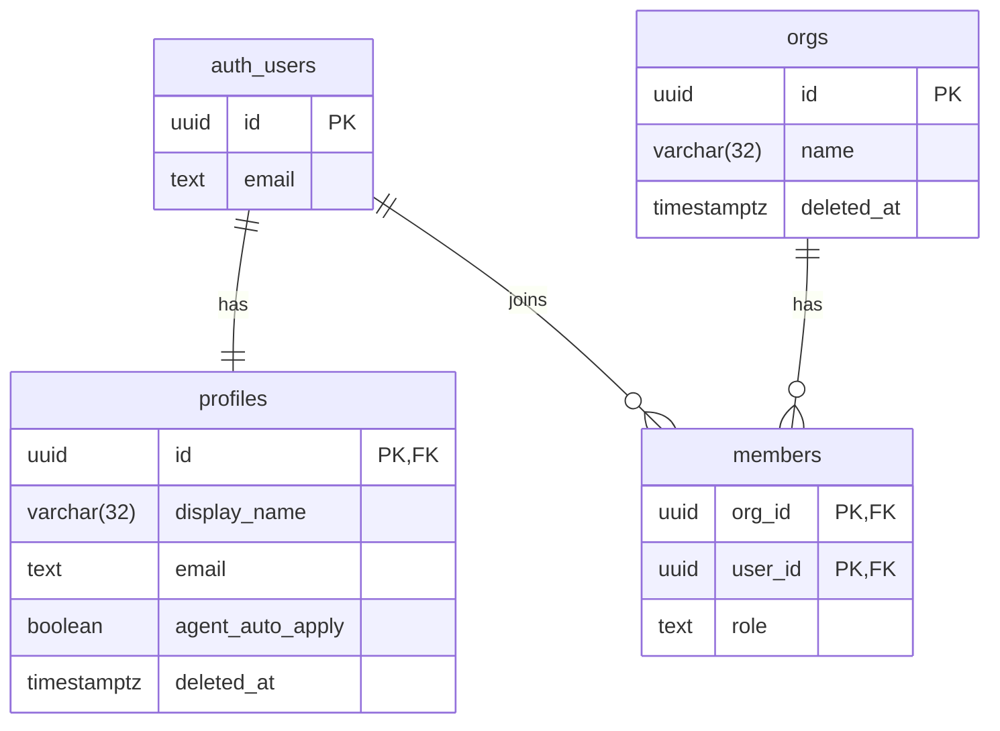
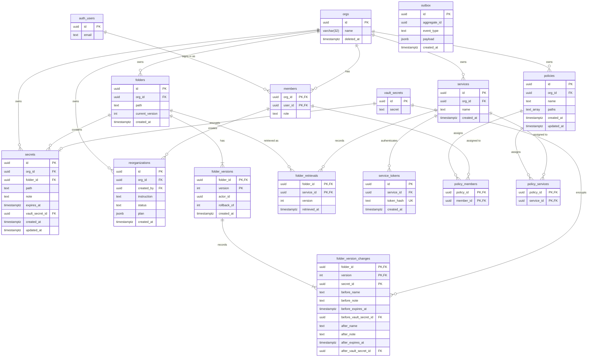

## Implemented schema

### Triggers

| Trigger | Table and event | Action |
| --- | --- | --- |
| `create_profile_after_user_insert` | `auth.users`, after each insert | Calls `public.create_profile_for_new_user()`, which inserts the user's `public.profiles` row. The initial `display_name` is the trimmed Google full name, then the email local part, then `User`, cut to 32 characters. It is never synced again. `email` is copied from `auth.users.email`. |

`profiles.email` copies `auth.users.email` once and is never synced again. Supabase Auth does not change `auth.users.email` when a returning user signs in with Google.
The trigger runs in the same transaction as the Auth write. If it fails, the Auth write rolls back.

### Scheduled jobs

`pg_cron` runs these jobs. Schedules use UTC.

| Job | Schedule | Action |
| --- | --- | --- |
| `delete-idle-sessions` | `0 3 * * *` (daily at 03:00) | Calls `public.delete_idle_sessions()`, which deletes `auth.sessions` rows not refreshed for 30 days. Their refresh tokens are deleted by cascade. |

### Functions for the API

The API role cannot read schema `auth`. It calls these `SECURITY DEFINER` functions instead.

| Function | Action |
| --- | --- |
| `public.list_user_sessions(target_user_id)` | Returns the user's active sessions: ID, user agent, and last used time. |
| `public.revoke_user_session(target_user_id, target_session_id)` | Deletes one session of the user. Returns whether it deleted a row. |

## Planned schema (preview)

### Supabase PostgreSQL

`auth.users` belongs to Supabase Auth, and `vault.secrets` belongs to Supabase Vault.
All other tables live in the `public` schema.

#### Domain model

The diagram uses the implemented `orgs` and `members` columns.
All other domain tables in this diagram are proposals, not implemented tables.
The proposed policy assignments and reorganization authors still need their membership references
aligned with the composite primary key before implementation.

| Table | Purpose |
| --- | --- |
| `orgs` | Organizations, identified by UUID and shown by name. |
| `members` | A user's role in an org: `owner`, `admin`, or `developer`. Each `(org_id, user_id)` pair is unique. |
| `folders` | A secret path without its last segment, unique per org. Created with its first secret and kept after its last one is gone, so its history stays available. A folder holds either secrets or subfolders, never both; a folder whose secrets are all gone can hold subfolders. `current_version` is the version that reads return. |
| `secrets` | The current state of each secret. `path` is unique per org; `note` and `expires_at` are optional. `vault_secret_id` references the current value. |
| `folder_versions` | The current version and up to N previous versions of each folder. One change creates at most one version per affected folder. `rollback_of` is the version a rollback restores. |
| `folder_version_changes` | What each version changed: a secret's name, note, expiration, and Vault entry before and after. Null `before_*` columns mean the secret was created or moved in; null `after_*` columns mean it was deleted or moved out. A rollback undoes the later changes in reverse order. A Vault entry is removed once neither `secrets` nor a kept change references it. |
| `folder_retrievals` | Each service's last-retrieved version and time per folder, kept as a single latest record. |
| `policies` | Read access to matching secret paths. Each entry in `paths` is an exact path or a prefix ending in `/*`. |
| `policy_members` | Assigns policies to members. |
| `policy_services` | Assigns policies to services. |
| `services` | Service identities. `name` is unique per org. |
| `service_tokens` | Hashes of service tokens. Revoking a token deletes its row. |
| `reorganizations` | AI reorganization proposals, `proposed` or `applied`. `plan` stores the moves, policy changes, and access diff returned by the API. |
| `outbox` | Domain events. A successful change writes its event in the same transaction; a denied or failed change attempt writes its event in a separate transaction. The outbox relay publishes them to Kafka, keyed by `aggregate_id`. |

### Aiven PostgreSQL

The `audit` service consumes Kafka events and owns this database. It records change attempts, including denied
and failed ones, and never stores secret values.

| Column | Type | Notes |
| --- | --- | --- |
| `id` | `uuid` | Primary key. Uses the outbox event ID, so redelivered events are inserted once. |
| `org_id` | `uuid` | |
| `actor_id` | `uuid` | The Supabase Auth user ID of the user who made the change. |
| `action` | `text` | For example, `folder.version_created`. |
| `target_type` | `text` | `secret`, `folder`, `policy`, `member`, or `service`. |
| `target_id` | `uuid` | Null when the attempt never created its target, such as a denied or failed create. |
| `outcome` | `text` | `success`; `denied` when authorization rejects the change; `failed` when an authorized change does not commit. |
| `occurred_at` | `timestamptz` | |

`audit_logs` has an index on `(org_id, occurred_at desc)` for the audit log API.
