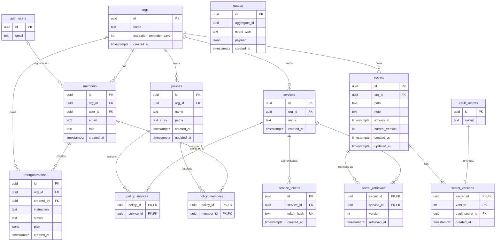

Keysy stores business data in Supabase PostgreSQL and audit records in Aiven PostgreSQL.
The schema follows the [PRD](/prd) and `openapi/api.yaml`.

## Supabase PostgreSQL

`auth.users` belongs to Supabase Auth, and `vault.secrets` belongs to Supabase Vault.
All other tables live in the `public` schema.

| Table | Purpose |
| --- | --- |
| `orgs` | Tenants. `expiration_reminder_days` holds the org's reminder lead time and defaults to 7. |
| `members` | A user's role in an org: `super_admin`, `admin`, or `user`. Admins add members by email, unique per org; `user_id` stays null until the first Google sign-in. |
| `secrets` | Secret metadata. `path` is unique per org; `note` and `expires_at` are optional. `current_version` points to the version that reads return. |
| `secret_versions` | The current version and up to N previous versions. Each row references one `vault.secrets` entry. Removing a version also removes its Vault entry. |
| `secret_retrievals` | Each service's last-retrieved version and time per secret, kept as a single latest record. |
| `policies` | Read access to matching secret paths. Each entry in `paths` is an exact path or a prefix ending in `/*`. |
| `policy_members` | Assigns policies to members. |
| `policy_services` | Assigns policies to services. |
| `services` | Service identities. `name` is unique per org. |
| `service_tokens` | Hashes of service tokens. Revoking a token deletes its row. |
| `reorganizations` | AI reorganization proposals, `proposed` or `applied`. `plan` stores the moves, policy changes, and access diff returned by the API. |
| `outbox` | Domain events. A successful change writes its event in the same transaction; a denied or failed change attempt writes its event in a separate transaction. The outbox relay publishes them to Kafka, keyed by `aggregate_id`. |

## Aiven PostgreSQL

The `audit` service consumes Kafka events and owns this database. It records change attempts, including denied
and failed ones, and never stores secret values.

| Column | Type | Notes |
| --- | --- | --- |
| `id` | `uuid` | Primary key. Uses the outbox event ID, so redelivered events are inserted once. |
| `org_id` | `uuid` | |
| `actor_id` | `uuid` | The Supabase Auth user ID of the user who made the change. |
| `action` | `text` | For example, `secret.version_created`. |
| `target_type` | `text` | `secret`, `policy`, `member`, or `service`. |
| `target_id` | `uuid` | Null when the attempt never created its target, such as a denied or failed create. |
| `outcome` | `text` | `success`; `denied` when authorization rejects the change; `failed` when an authorized change does not commit. |
| `occurred_at` | `timestamptz` | |

`audit_logs` has an index on `(org_id, occurred_at desc)` for the audit log API.
