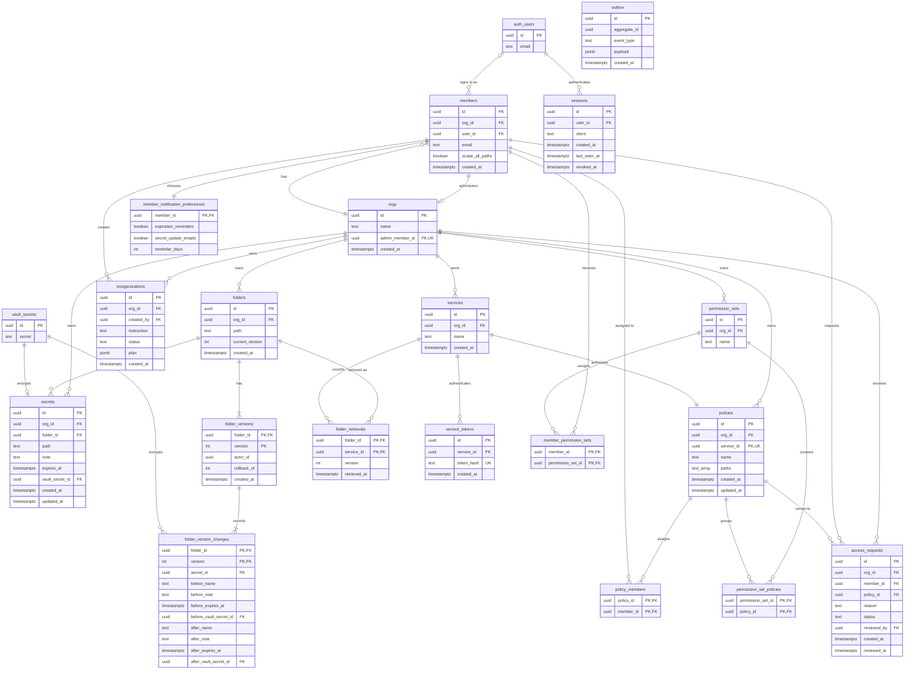

Keysy stores business data in Supabase PostgreSQL and audit records in Aiven PostgreSQL.
The schema follows the [PRD](/prd) and `openapi/api.yaml`.

## Supabase PostgreSQL

`auth.users` belongs to Supabase Auth, and `vault.secrets` belongs to Supabase Vault.
All other tables live in the `public` schema.

| Table | Purpose |
| --- | --- |
| `orgs` | Tenants. The non-null `admin_member_id` identifies exactly one Admin. It must reference a signed-in member of this org. Create the org and its first membership in one transaction, with a deferred foreign key. |
| `members` | Org membership. The API derives `admin` from `orgs.admin_member_id`; every other member is a `developer`. The Admin adds members by email, unique per org; `user_id` stays null until the first Google sign-in. `scope_all_paths` preserves full scope when an Admin transfers the role and becomes a Developer. It is not a third role. Only the Admin can change scopes. |
| `folders` | A secret path without its last segment, unique per org. Created with its first secret and kept after its last one is gone, so its history stays available. `current_version` is the version that reads return. |
| `secrets` | The current state of each secret. `path` is unique per org; `note` and `expires_at` are optional. `vault_secret_id` references the current value. |
| `folder_versions` | The current version and up to N previous versions of each folder. One change creates at most one version per affected folder. `rollback_of` is the version a rollback restores. |
| `folder_version_changes` | What each version changed: a secret's name, note, expiration, and Vault entry before and after. Null `before_*` columns mean the secret was created or moved in; null `after_*` columns mean it was deleted or moved out. A rollback undoes the later changes in reverse order. A Vault entry is removed once neither `secrets` nor a kept change references it. |
| `folder_retrievals` | Each service's last-retrieved version and time per folder, kept as a single latest record. |
| `policies` | Each policy belongs to exactly one service through non-null, unique `service_id`. Each `paths` entry names an exact folder or a folder prefix ending in `/*`, never a single secret. Services receive read access; assigned policies contribute read/write scope to Developers. |
| `policy_members` | Direct policy assignments to members. Only the Admin can change assignments. |
| `permission_sets` | Named, reusable groups of policies, unique by `(org_id, name)`. Only the Admin can manage them. |
| `permission_set_policies` | Policies in a permission set. Each referenced policy belongs to the same org as the set. |
| `member_permission_sets` | Permission sets assigned to members by the Admin. Effective scope is the union of direct policies and these sets, or every path when `scope_all_paths` is true. |
| `access_requests` | A Developer's policy access request and optional reason. Status is `pending`, `approved`, or `declined`. Only one pending request may exist per member and policy. Approval adds a direct policy assignment in the same transaction. `reviewed_by` and `reviewed_at` are null until review. |
| `member_notification_preferences` | Per-member, per-org preferences through the membership ID. Both email options start on for the Admin and off for Developers. `reminder_days` is positive; the initial lead time remains undecided. Check scope again before sending. Do not send a secret update email to its actor. |
| `sessions` | Keysy session metadata keyed by the Supabase session ID. Client is `web`, `cli`, or `extension`. Store no bearer or refresh tokens. On each API request and token refresh, reject a session with `revoked_at` set; provider token revocation alone does not invalidate an issued JWT immediately. |
| `services` | Service identities. `name` is unique per org. Create and delete a service and its one policy atomically; a service must never commit without a policy. |
| `service_tokens` | Hashes of service tokens. Revoking a token deletes its row. |
| `reorganizations` | AI reorganization proposals, `proposed` or `applied`. `plan` stores the moves, policy changes, and access diff returned by the API. |
| `outbox` | Domain events. A successful change writes its event in the same transaction; a denied or failed change attempt writes its event in a separate transaction. The outbox relay publishes them to Kafka, keyed by `aggregate_id`. |

### Integrity and authorization

- Use same-org foreign keys for member, policy, permission-set, request and service relationships. For example, make `(org_id, id)` unique on members and use `(id, admin_member_id)` on orgs to reference it. Defer the owner foreign key until commit so org creation can insert both rows.
- Derive the two API roles instead of storing a second role column that could disagree with the owner. Transfer ownership and set the previous Admin's `scope_all_paths` in one transaction. Reject removal of the current Admin.
- Enforce one policy per service with unique `policies.service_id`, a deferred constraint trigger that rejects a service without a policy, and a transaction for both rows. Deleting the service removes its policy, tokens, grants, permission-set links and access requests; audit records remain separate.
- Before a Developer manages a service or policy, check every policy path before and after the change against the Developer's scope before the change. A caller cannot grant themselves a larger scope through a policy update.
- Enforce unique `(org_id, path)` for folders and secrets. Keep folder versions and changes atomic. Invalidate affected cache entries on writes and recheck authorization on cache reads.
- Scope assignments and permission-set changes take effect on the next request. Developers can see other members' roles, but cannot see their scopes or audit records for membership and scope changes.
- Deleting an account is blocked while it owns any org. Otherwise remove its memberships and revoke its sessions. An unreachable Admin requires a support verification procedure; that procedure remains to be specified.
- Supabase Vault keeps encrypted values and the encryption key separate. Restrict access to decrypted views to authorized backend code. This protects a database dump; it is not end-to-end encryption or protection from a compromised authorized backend.

This page specifies the target schema. It is not a database migration or proof of deployed constraints.

## Aiven PostgreSQL

The `audit` service consumes Kafka events and owns this database. It records change attempts, including denied
and failed ones, and never stores secret values.

| Column | Type | Notes |
| --- | --- | --- |
| `id` | `uuid` | Primary key. Uses the outbox event ID, so redelivered events are inserted once. |
| `org_id` | `uuid` | |
| `actor_id` | `uuid` | The Supabase Auth user ID of the user who made the change. |
| `action` | `text` | For example, `folder.version_created`. |
| `target_type` | `text` | `secret`, `folder`, `policy`, `member`, `service`, `org`, `permission_set`, or `access_request`. |
| `target_id` | `uuid` | Null when the attempt never created its target, such as a denied or failed create. |
| `scope_paths` | `text[]` | Immutable affected folder paths. For a policy record, include every path before and after the change, so filtering does not depend on a later policy edit. Null for org-level or member-access records. |
| `outcome` | `text` | `success`; `denied` when authorization rejects the change; `failed` when an authorized change does not commit. |
| `occurred_at` | `timestamptz` | |

`audit_logs` has an index on `(org_id, occurred_at desc)` for the audit log API.
The outbox event includes `org_id`, actor, action, target, outcome, time and scope paths, without secret values.
The API applies the caller's current scope to these immutable paths. Developers can read a policy record only
when every recorded path is in scope. Only the Admin can read member, scope, permission-set and Admin role records.
Audit retention is independent of folder version retention; the retention period and account-erasure procedure remain undecided.
